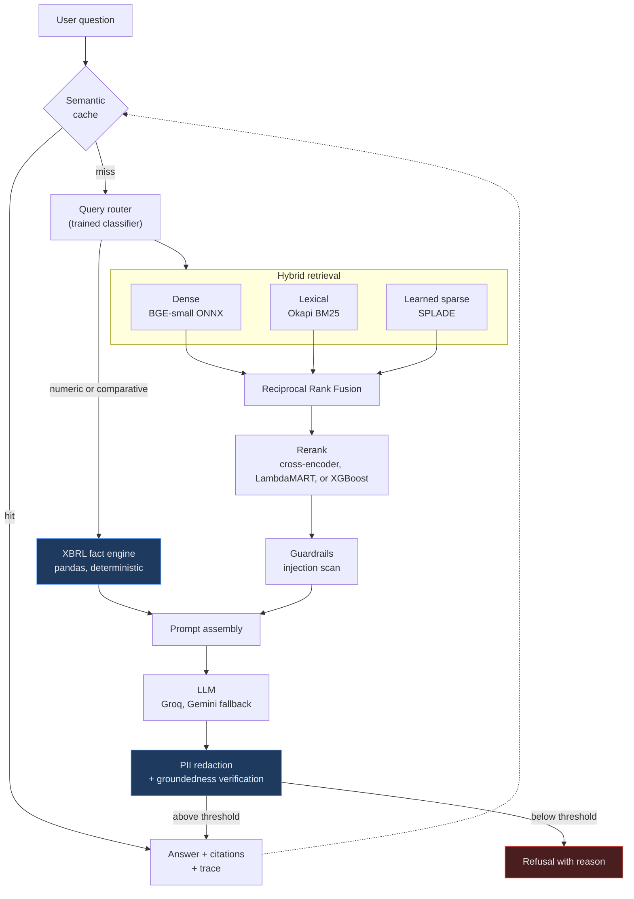

# sec-rag-platform

**Evaluation-driven retrieval-augmented generation over SEC filings.**

[](https://github.com/AlgoPhantom001/Evaluation-Driven-Advanced-RAG-Platform-for-Financial-Documents/actions/workflows/ci.yml)
[](https://github.com/AlgoPhantom001/Evaluation-Driven-Advanced-RAG-Platform-for-Financial-Documents/actions/workflows/eval.yml)
[](https://www.python.org)
[](LICENSE)

A question answering system over 10-K filings that hybrid-retrieves across three
independent arms, reranks with a cross-encoder, computes financial figures from
filed XBRL data rather than generating them, verifies that every answer is
supported by the passages it cites, and **fails its own build when retrieval or
answer quality regresses.**

---

## Architecture



Each retrieval arm fails differently, which is the reason to keep all three.
Dense retrieval understands paraphrase but blurs near-identical identifiers, so
"Item 9A" and "Item 9B" land in nearly the same place. BM25 is exact but blind
to synonyms. SPLADE expands terms in learned rather than lexical space. Fusing
them recovers documents any single arm would have missed.

---

## What is measured

Every number below is produced by `secrag benchmark` and `secrag eval` against
the golden set in [`evals/goldens/golden_set.json`](evals/goldens/golden_set.json),
and regenerated in CI. Nothing here is an estimate.

<!-- BENCHMARK:START -->
Corpus: **3,609 chunks** across 33 golden queries. Dense `BAAI/bge-small-en-v1.5`, sparse `prithivida/Splade_PP_en_v1`, reranker `Xenova/ms-marco-MiniLM-L-6-v2`. Latency is single-threaded CPU.

| Configuration | nDCG@6 | Hit@6 | MRR | P@6 | Recall@6 | Mean ms | p95 ms |
|---|---:|---:|---:|---:|---:|---:|---:|
| dense only | 0.707 | 0.818 | 0.685 | 0.545 | 0.818 | 105 | 117 |
| bm25 only | 0.668 | 0.758 | 0.649 | 0.490 | 0.758 | 13 | 17 |
| splade only | 0.742 | 0.879 | 0.702 | 0.535 | 0.879 | 832 | 908 |
| dense + bm25 | 0.709 | 0.818 | 0.683 | 0.550 | 0.818 | 104 | 126 |
| dense + bm25 + splade | 0.723 | 0.849 | 0.686 | 0.561 | 0.849 | 1150 | 1262 |
| hybrid + LTR \* | 0.939 | 0.939 | 0.939 | 0.929 | 0.939 | 1209 | 1342 |
| hybrid + XGB \* | 0.937 | 0.939 | 0.939 | 0.904 | 0.939 | 1197 | 1352 |
| hybrid + cross-encoder | 0.758 | 0.879 | 0.713 | 0.561 | 0.879 | 3044 | 3487 |

\* Trained on these same queries, so this row is training-set performance and is optimistic. Its honest grouped cross-validation score is reported separately below.

Best configuration that is not scored in-sample is **hybrid + cross-encoder** at nDCG@6 0.758, **+7.2%** against dense-only retrieval (0.707). It costs 3044 ms mean against 105 ms.

**Reading this honestly.** Three things in that table are worth stating plainly rather than glossing over:

- Learned sparse retrieval alone (0.742) beats dense alone (0.707) on this corpus, and beats three-arm fusion (0.723). Fusion is not free: mixing in weaker arms can pull a strong one down.
- The cross-encoder's gain over fusion is real but modest, and it costs roughly 2.6x the latency. Whether that trade is worth making depends entirely on the application.
- With only 33 queries, differences below roughly 0.05 nDCG should not be treated as meaningful. The suite is sized to catch regressions, not to rank models.

**The learning-to-rank reranker.** Trained on the golden set, so its row above is training-set performance. Under grouped cross-validation, splitting by query so no query appears in both folds, it scores **nDCG 0.679** against **0.601** for plain fusion order, a lift of **+0.078** over 30 queries and 1,200 candidates. That is the number to believe.

Its most informative features, by gain: `section_id` (296), `rrf_score` (214), `numeric_density` (128), `token_estimate` (96). That `section_id` dominates is a real finding: which 10-K Item a passage came from predicts relevance better than any similarity score, which is why section is a first-class field throughout the pipeline rather than loose metadata.

**The XGBoost ranker.** Same feature matrix, same grouped cross-validation protocol as the LightGBM LTR above. It scores **nDCG@6 0.678** vs **0.601** for plain fusion order (MRR 0.775 vs 0.730, Recall@6 0.238 vs 0.209). The two rankers land within ~0.001 of each other on this split, which is the honest takeaway: the feature matrix carries the signal, not the gradient-boosting backend.
<!-- BENCHMARK:END -->

### Query router

Intent classification over dense embeddings plus explicit lexical signals,
scored by 5-fold cross-validation so the number comes from folds the model never
saw.

<!-- ROUTER:START -->
| Metric | Value |
|---|---:|
| Cross-validated accuracy | **0.960** |
| Macro F1 | 0.960 |
| Labelled examples | 101 |
| Features | 392 (384 dense + 8 lexical) |

Per-class F1: `comparative` 0.957, `factoid` 0.947, `multi_hop` 0.957, `numeric` 0.981.
<!-- ROUTER:END -->

The pair that motivates the whole router:

| Question | Route | Why it matters |
|---|---|---|
| "What was Apple's revenue in fiscal 2024?" | `numeric` | Answer computed from XBRL |
| "What does Apple say about revenue growth drivers?" | `factoid` | Answer read from the narrative |

Both mention revenue and a company. Only the first wants a figure. Routing the
second to the arithmetic engine returns nothing useful; routing the first to the
language model invites a fabricated number.

### Answer quality

Measured with the offline provider, which is why the numbers are reproducible.
Retrieval and routing metrics do not involve a language model at all. Citation
and groundedness metrics do, and the offline provider writes extractive answers,
so they measure whether the citation and verification machinery works rather
than how well a particular model writes. Configure a real provider and re-run
`secrag eval` to measure that.

<!-- EVAL:START -->
33 golden cases against 3,609 indexed chunks, reranker `cross_encoder`, provider `echo:echo-1`.

| Metric | Value | CI threshold | | What it means |
|---|---:|---:|:--:|---|
| Hit rate@6 | **0.879** | 0.80 | pass | at least one relevant passage in the top 6 |
| nDCG@6 | **0.752** | 0.68 | pass | ranking quality |
| MRR | **0.713** | 0.65 | pass | rank of the first relevant passage |
| Citation validity | **1.000** | 0.95 | pass | markers that point at a real source |
| Groundedness | **0.781** | 0.65 | pass | answer sentences supported by their citation |
| Numeric accuracy | **1.000** | 0.90 | pass | XBRL figures within tolerance |
| Routing accuracy | **0.970** | 0.85 | pass | intent matched the golden label |
| Refusal correctness | **0.970** | 0.85 | pass | declined exactly when it should |

The gate passes. Thresholds live in [`evals/thresholds.json`](evals/thresholds.json) and are enforced by `secrag eval --gate` in CI.
<!-- EVAL:END -->

---

## Quickstart

```bash
git clone https://github.com/AlgoPhantom001/Evaluation-Driven-Advanced-RAG-Platform-for-Financial-Documents.git
cd sec-rag-platform

python -m venv .venv && source .venv/bin/activate      # Windows: .venv\Scripts\activate
pip install -e ".[dev]"

cp .env.example .env        # add a free Groq or Gemini key, and your contact email
```

EDGAR requires a descriptive `User-Agent` containing a contact address. Set
`SECRAG_EDGAR_USER_AGENT` before ingesting or requests will be refused.

```bash
secrag ingest              # fetch, chunk, embed, and index the demo corpus
secrag train-router        # train the intent classifier
secrag train-ltr           # train the LightGBM learning-to-rank reranker
secrag train-xgb           # train the XGBoost rank:ndcg reranker

secrag query "What supply chain risks does Apple disclose?"
secrag query "What was Apple's gross margin in fiscal 2024?"

secrag eval --gate         # run the golden set, exit non-zero on regression
secrag benchmark           # ablate retrieval arms and rerankers

secrag serve               # API and web UI on http://localhost:7860
```

Docker:

```bash
docker compose up --build
```

The image pre-bakes the ONNX weights, so the container starts in about five
seconds rather than downloading models on first request.

### Running with no API key

The whole test and evaluation suite runs offline. `EchoProvider` parses the
retrieved context out of the prompt and composes a real extractive answer with
real citations, so citation validity, groundedness, and refusal logic are all
exercised without a network call. That is why CI needs no secrets.

---

## API

| Endpoint | Purpose |
|---|---|
| `POST /v1/query` | Answer with citations, verified figures, groundedness score |
| `POST /v1/query/stream` | Server-sent events. Sources arrive before the first token |
| `GET /v1/stats` | Corpus size, models, provider chain, cache statistics |
| `GET /metrics` | Prometheus text exposition |
| `GET /health`, `GET /ready` | Liveness and readiness, separated deliberately |
| `GET /docs` | OpenAPI |

The web UI in `ui/index.html` runs a Gradio front end over the same engine.
The FastAPI service above is what the Docker image and `secrag serve` run,
and both call identical code.

```bash
curl -s localhost:7860/v1/query \
  -H 'content-type: application/json' \
  -d '{"question":"What was Apple gross margin in fiscal 2024?","top_k":6}' | jq
```

Every response carries a `trace_id`, per-stage timings, token counts, and an
estimated cost at published list prices.

---

## Project layout

```
src/secrag/
├── core/           Settings, typed errors, domain models, logging
├── providers/      LLM abstraction: Groq, Gemini, deterministic offline
├── ingest/         EDGAR client, 10-K parser, chunker, XBRL fact engine
├── retrieval/      Embedder, Qdrant store, BM25, RRF fusion, rerankers
├── routing/        Query intent classifier and its labelled dataset
├── analytics/      Numeric query planner over XBRL facts
├── generation/     Prompts, synthesis, groundedness verification
├── guardrails/     Prompt-injection detection, PII redaction
├── evaluation/     Metrics, golden set, harness, ablation, LTR training
├── observability/  Tracing, token accounting, metrics registry
├── api/            FastAPI service
└── engine.py       The orchestrator that sequences all of it
```

---

